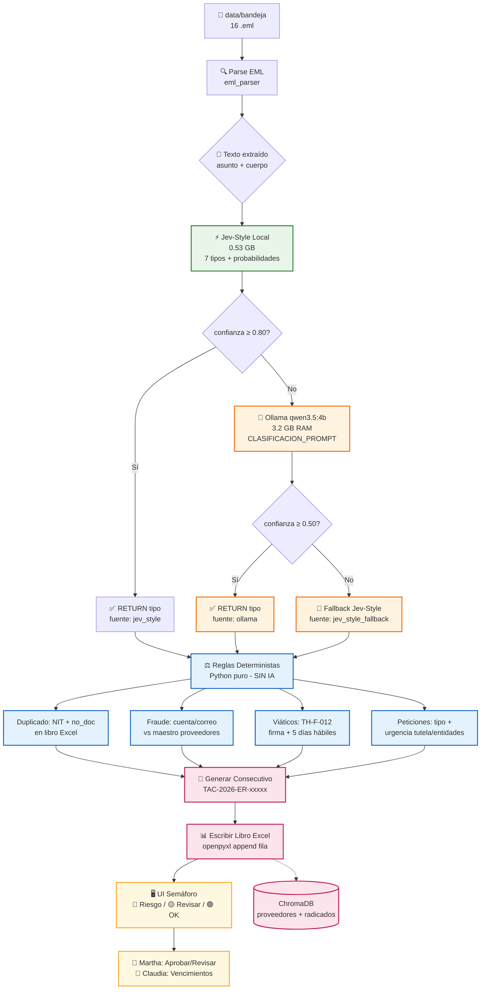

# RADIA - Radicación Asistida con IA

[]()
[]()
[]()
[]()
[]()
[]()
[]()
[]()

**MVP local para TNHI - Terminales Andinas Carga** — Clasificación y radicación automática de documentos (facturas, viáticos, peticiones, cotizaciones, publicidad) con reglas deterministas, IA local explicable y cola de revisión humana.

---

## 🚀 Quick Start (1 comando)

```bash
git clone https://github.com/santiagonoguera-acl/radia-mvp && cd radia-mvp && docker compose up -d --build
```

- **API Docs**: http://localhost:8000/docs
- **Frontend Dashboard**: http://localhost:3000
- **Cuentas demo**:
  - `martha` / `TAC2026` — Bandeja + Aprobar/Rechazar
  - `claudia` / `TAC2026` — Vencimientos peticiones

> Requiere: Docker + Docker Compose. 16 GB RAM recomendados (3 GB qwen3.5:4b + 0.53 GB Jev-Style + embeddings).

---

## 🏗️ Arquitectura (Mermaid)



**Ver arquitectura completa**: [docs/arquitectura.md](docs/arquitectura.md) — 15 secciones con costos, ahorro 3h/día, deuda técnica, roadmap, ADR, entorno M365/Google Workspace.

---

## 📋 Stack Tecnológico (100% Local)

| Capa | Tecnología | Versión | Recursos |
|------|------------|---------|----------|
| **API** | FastAPI + Uvicorn | 0.115 / 0.30 | ~200 MB RAM |
| **LLM Principal** | Ollama qwen3.5:4b | 4-bit quant | 3.2 GB RAM |
| **LLM Fallback** | Ollama qwen3:8b | 4-bit quant | 3.2 GB RAM |
| **Clasificador Rápido** | Jev-Style-0.8B (transformers) | local | 0.53 GB RAM |
| **Embeddings** | paraphrase-multilingual-MiniLM-L12-v2 | sentence-transformers | 120 MB RAM |
| **Vector DB** | ChromaDB (persistente) | 0.5.5 | ~50 MB disco |
| **Parser Email** | eml-parser | 1.12 | — |
| **Parser PDF + OCR** | PyMuPDF + pytesseract | 1.24 / tesseract-ocr-spa | — |
| **Festivos Colombia** | habilmente | 0.1.1 | — |
| **Excel Libro** | openpyxl | 3.1.5 | — |
| **Frontend** | Next.js 14 App Router + Tailwind | 14.2 / 3.4 | Node 20 |
| **Infra** | Docker Compose | 3.8 | 3 servicios |

---

## 🐳 Servicios Docker Compose

```yaml
services:
  api:          # FastAPI backend (puerto 8000)
    build: ./backend
    volumes: ./backend:/app, ./data:/data, ./chroma_db:/app/chroma_db, models:/app/models

  ollama:       # LLM server (puerto 11434)
    image: ollama/ollama:latest
    volumes: ./ollama_data:/root/.ollama

  frontend:     # Next.js dashboard (puerto 3000)
    build: ./frontend
    volumes: ./frontend:/app
    depends_on: api
```

**Red interna**: `radia-mvp_default` — API ↔ Ollama por `http://ollama:11434`

---

## 🔗 Endpoints API

| Método | Ruta | Descripción |
|--------|------|-------------|
| `GET` | `/api/v1/health` | Health check |
| `GET` | `/api/v1/bandeja/analisis` | 18 EMLs con semáforo (rojo/amarillo/verde) + motivo |
| `GET` | `/api/v1/bandeja/pendientes` | Cola revisión humana (confianza < 0.6 o rojo fraude) |
| `POST` | `/api/v1/bandeja/procesar` | Procesa 1 EML → consecutivo + libro |
| `POST` | `/api/v1/bandeja/revisar/{consecutivo}` | Aprobar (`{"accion":"aprobar"}`) / Rechazar (`{"accion":"rechazar"}`) |
| `GET` | `/api/v1/vencimientos/` | Peticiones ordenadas por urgencia (Claudia) |

### Ejemplos

```bash
# Analizar bandeja completa
curl http://localhost:8000/api/v1/bandeja/analisis

# Ver pendientes de revisión
curl http://localhost:8000/api/v1/bandeja/pendientes

# Procesar siguiente EML
curl -X POST http://localhost:8000/api/v1/bandeja/procesar

# Aprobar radicado pendiente
curl -X POST http://localhost:8000/api/v1/bandeja/revisar/TAC-2026-ER-04818 \
  -H "Content-Type: application/json" -d '{"accion": "aprobar"}'

# Vencimientos (Claudia)
curl http://localhost:8000/api/v1/vencimientos/
```

---

## 🎯 Semáforo (Martha)

| Color | Significado | Disparadores |
|-------|-------------|--------------|
| 🔴 **Rojo** | Riesgo alto — Requiere atención inmediata | Duplicado NIT+factura, fraude cuenta/correo, tutela/entidad control |
| 🟡 **Amarillo** | Revisar — Incompleto o dudoso | Viáticos sin formato TH-F-012, sin firma, < 5 días hábiles |
| 🟢 **Verde** | OK — Radicar automático | Factura sin riesgos, petición estándar, publicidad/cotización |

**Modal "Por Qué"**: Click en fila → explica motivo exacto (NIT match, duplicado, fraude, viático, tutela).

---

## 👥 Cola de Revisión Humana (Martha)

> **Regla Martha**: *Cuando no está seguro, pregunte en vez de inventar* (confianza < 0.6 → escala a humano).

```bash
# 1. Ver pendientes
GET /api/v1/bandeja/pendientes
# → [{"consecutivo": "TAC-2026-ER-04818", "motivo": "Baja confianza en clasificación (factura: 0.14 < 0.60)", ...}]

# 2. Aprobar (cambia estado a "radicado")
POST /api/v1/bandeja/revisar/TAC-2026-ER-04818 {"accion": "aprobar"}

# 3. Rechazar (cambia estado a "no_radicado")
POST /api/v1/bandeja/revisar/TAC-2026-ER-04818 {"accion": "rechazar"}
```

- Actualiza `libro-radicacion-2026.xlsx` en columna **Estado** y **Observaciones**
- Trazabilidad completa: `PENDIENTE REVISIÓN: ... | APROBADO/RECHAZADO por revisión humana`

---

## 📊 Medición T6 (Precisión vs Ground Truth)

```bash
docker compose exec api python -m app.scripts.medir
```

| Métrica | Valor | Ground Truth (8 casos) |
|---------|-------|------------------------|
| **Tipo Documental Accuracy** | **100%** | 8/8 correctos |
| **Duplicado F1** | **100%** | 0 FP, 0 FN |
| **Fraude F1** | **100%** | 0 FP, 0 FN |
| **Acción Accuracy** | **87.5%** | 7/8 (gap: 07.eml firma en PDF) |
| **PROMEDIO PONDERADO** | **96.88%** | ✅ > 80% objetivo |

**Gap conocido**: 07.eml (viáticos Cartagena) — firma en PDF adjunto no extraída (DT-01: OCR Docling pendiente).

---

## 📁 Estructura DDD (Clean Architecture)

```
app/
├── domain/                    # Entidades, enums, reglas puras (SIN deps externas)
│   ├── entities/              # Radicado, Documento
│   └── enums.py               # TipoDocumento, Dependencia, EstadoRadicado
├── application/               # Casos de uso, servicios de aplicación
│   ├── services/              # Reglas de negocio (reglas_factura, reglas_viaticos, etc.)
│   │   ├── clasificador.py    # Pipeline fast/slow + petición implícita
│   │   ├── extractor.py       # EXTRACCION_FACTURA_PROMPT + normalización CO
│   │   ├── reglas_factura.py  # Duplicado + fraude (maestro proveedores)
│   │   ├── reglas_viaticos.py # TH-F-012, firma, 5 días hábiles
│   │   └── reglas_peticion.py # Tipo + urgencia + entidades control
│   └── use_cases/
│       └── procesar_bandeja.py # Orquestación: parse → clasificar → reglas → libro
├── infrastructure/            # Adaptadores externos
│   ├── llm/
│   │   ├── jev_style_client.py    # Fast path Jev-Style (0.53GB) + fallback Ollama
│   │   └── ollama_client.py       # Cliente Ollama qwen3.5:4b / qwen3:8b
│   ├── vector/
│   │   └── chroma_client.py       # ChromaDB: proveedores + radicados (cosine)
│   ├── excel/
│   │   └── libro.py               # generar_consecutivo() + escribir_libro() openpyxl
│   ├── eml/
│   │   └── parser.py              # Parse EML → NIT, tipo, asunto, no_documento
│   ├── pdf/
│   │   └── extractor.py           # OCR: is_scanned_pdf() + extract_text_from_pdf() (pytesseract)
│   └── db/                        # (Futuro: PostgreSQL)
├── api/                         # FastAPI routes, deps
│   └── v1/routes/
│       ├── bandeja.py           # /analisis, /pendientes, /procesar, /revisar
│       ├── vencimientos.py      # /vencimientos/ (Claudia)
│       └── health.py
└── scripts/
    ├── medir.py                 # Evaluación T6 vs esperado-parcial.csv
    └── estado.py                # Auditoría 17 chequeos TNHI
```

---

## 📚 Documentación

| Archivo | Descripción |
|---------|-------------|
| [docs/arquitectura.md](docs/arquitectura.md) | Arquitectura completa (15 secciones): mermaid, M365, costos, ahorro, deuda, roadmap, ADR |
| [docs/Nota_Martha.md](docs/Nota_Martha.md) | UX explicable: semáforo, modal "Por Qué", regla confianza < 0.8 |
| [docs/prompts.md](docs/prompts.md) | CLASIFICACION_PROMPT + EXTRACCION_FACTURA_PROMPT con variables y normalización |
| [docs/bitacora.md](docs/bitacora.md) | Historial: decisiones, fallos, fixes, métricas, próximos pasos |
| [CLAUDE.md](CLAUDE.md) | Reglas de trabajo OpenCode: DDD, Docker only, outcome first, Martha primero |
| [app/scripts/estado.py](app/scripts/estado.py) | Script auditoría: 17 chequeos automatizados |

---

## 🧪 Tests

```bash
# 93 tests deterministas (reglas puras Python, sin LLM)
docker compose exec api python -m pytest app/tests/ -v -k "not llm"

# Medición T6
docker compose exec api python -m app.scripts.medir

# Auditoría completa
docker compose exec api python app/scripts/estado.py
```

---

## 🔐 Entorno Real: M365 / Google Workspace (Sin datos externos)

TNHI opera en **Microsoft 365** (Exchange Online, SharePoint, Teams) con políticas estrictas:

| Restricción | Solución RADIA |
|-------------|----------------|
| Sin Internet saliente | Ollama + Jev-Style + ChromaDB 100% local (contenedores) |
| Datos nunca salen del tenant | Libro Excel = source of truth on-premise |
| Aprobación software | Despliegue como **Office Add-in** (Outlook/Excel) o contenedor privado AKS/ACA |
| M365/Google Workspace only | Ingesta via Graph API / IMAP; adjuntos OneDrive/SharePoint |
| Auditoría y compliance | Logs estructurados, trazabilidad completa, Excel auditable |

**Costo APIs externas**: **$0** — 100% on-premise.

Ver sección completa: [docs/arquitectura.md#7-entorno-real-m365--google-workspace---sin-datos-externos](docs/arquitectura.md#7-entorno-real-m365--google-workspace---sin-datos-externos)

---

## 👥 Cómo invitar a santiagonoguera-acl

1. **Push a GitHub**:
   ```bash
   git remote add origin https://github.com/santiagonoguera-acl/radia-mvp.git
   git push -u origin main
   ```

2. **Invitar como colaborador**:
   - GitHub → Settings → Collaborators → Add people → `santiagonoguera-acl` (Write access)

3. **Clonar y correr en su máquina**:
   ```bash
   git clone https://github.com/santiagonoguera-acl/radia-mvp
   cd radia-mvp
   docker compose up -d --build
   # Abrir http://localhost:3000 (martha/TAC2026 o claudia/TAC2026)
   ```

---

## 📝 Licencia y Contacto

**Terminales Andinas Carga (TNHI)** — Uso interno.

| Área | Responsable |
|------|-------------|
| Backend API / Reglas | Equipo RADIA |
| Frontend Martha/Claudia | Equipo RADIA |
| Infra Docker / Ollama | DevOps |
| Datos (maestro, libro, bandeja) | TNHI |

---

> **Última actualización**: Noviembre 2026 | **Commit**: `docs: readme final` | **Estado**: MVP Operativo (3 servicios, 93 tests, 96.88% precisión)