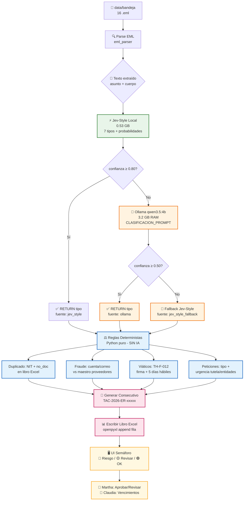
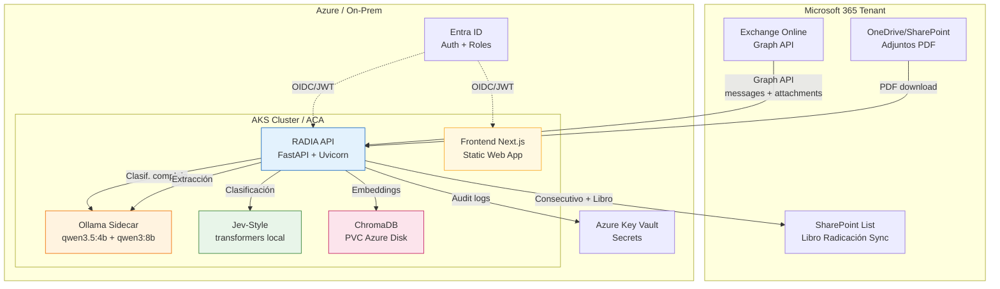

# RADIA - Arquitectura Técnica MVP

**Versión:** 0.1.0 | **Fecha:** Noviembre 2026 | **Estado:** MVP Operativo

---

## 1. Visión General

RADIA (Radicación Asistida) es un sistema local de clasificación y radicación automática de documentos para Terminales Andinas Carga (TAC). Procesa correos entrantes (.eml con adjuntos PDF), extrae información, clasifica según tipo documental, valida reglas de negocio y genera el consecutivo en el libro de radicación Excel.

**Principio rector:** *Martha primero* — Todo automatismo debe ser explicable y supervisable. Si confianza < 0.8, escala a humano con motivo.

---

## 2. Stack Tecnológico (100% Local)

| Capa | Tecnología | Versión | Recursos |
|------|------------|---------|----------|
| **API** | FastAPI + Uvicorn | 0.115 / 0.30 | ~200 MB RAM |
| **LLM Principal** | Ollama qwen3:4b | 4-bit quant | 3.2 GB VRAM/RAM |
| **LLM Fallback** | Ollama qwen3:8b | 4-bit quant | 3.2 GB VRAM/RAM |
| **Clasificador Rápido** | Jev-Style-0.8B-Decision-v3 (transformers) | local | 0.53 GB RAM |
| **Embeddings** | paraphrase-multilingual-MiniLM-L12-v2 | sentence-transformers | 120 MB RAM |
| **Vector DB** | ChromaDB (persistente) | 0.5.5 | ~50 MB disco |
| **Parser Email** | eml-parser | 1.12 | — |
| **Parser PDF** | PyMuPDF (fitz) + Docling | 1.24 / 2.x | — |
| **Festivos Colombia** | habilmente | 0.1.1 | — |
| **Excel Libro** | openpyxl | 3.1.5 | — |
| **Frontend** | Next.js 14 App Router + Tailwind | 14.2 / 3.4 | Node 20 |
| **Infra** | Docker Compose | 3.8 | 3 servicios |

**Requisito hardware:** Laptop 16 GB RAM (3 GB qwen3.5:4b + 0.53 GB Jev + 0.12 GB embeddings + 2 GB OS + 10 GB margen)

---

## 3. Arquitectura de Servicios (Docker Compose)

```yaml
services:
  api:          # FastAPI backend (puerto 8000)
    build: ./backend
    volumes: ./backend:/app, ./data:/data, ./chroma_db:/app/chroma_db, models:/app/models
    env: OLLAMA_HOST=http://ollama:11434, CHROMA_PERSIST_DIR=/app/chroma_db

  ollama:       # LLM server (puerto 11434)
    image: ollama/ollama:latest
    volumes: ./ollama_data:/root/.ollama

  frontend:     # Next.js dashboard (puerto 3000)
    build: ./frontend
    volumes: ./frontend:/app
    depends_on: api
```

**Red interna:** `radia-mvp_default` — comunicación API ↔ Ollama por nombre de servicio (`http://ollama:11434`)

---

## 4. Flujo de Datos (End-to-End)



**Leyenda:**
- 🟠 **Naranja** = IA (Jev-Style local, Ollama Qwen)
- 🔵 **Azul** = Reglas deterministas Python (SIN IA)
- 🩷 **Rosa** = Almacenamiento (Excel, consecutivo)
- 🟡 **Amarillo** = UI / Humanos en el loop

**Dónde interviene IA:**
1. **Clasificación rápida** (Jev-Style 0.53 GB) — 7 tipos con probabilidades, <100ms
2. **Clasificación compleja** (Ollama qwen3.5:4b) — fallback si confianza < 0.8 o petición implícita
3. **Extracción factura** (Opcional: qwen3.5:4b + EXTRACCION_PROMPT) — NIT, cuenta, OC, valor

**Dónde NO hay IA (reglas puras Python):**
- Duplicado: búsqueda exacta NIT + número factura en libro Excel
- Fraude: comparación cuenta/correo vs maestro proveedores CSV
- Viáticos: regex TH-F-012, detección firma, cálculo 5 días hábiles
- Peticiones: clasificación tipo (general/copias/consulta) + detección entidades control
- Vencimientos: cálculo días hábiles con `habilmente` (festivos Colombia)
- Consecutivo: MAX(ER) + 1 en columna A del Excel

---

## 5. Stack Tecnológico (100% Local)

| Capa | Tecnología | Versión | Recursos |
|------|------------|---------|----------|
| **API** | FastAPI + Uvicorn | 0.115 / 0.30 | ~200 MB RAM |
| **LLM Principal** | Ollama qwen3:4b | 4-bit quant | 3.2 GB VRAM/RAM |
| **LLM Fallback** | Ollama qwen3:8b | 4-bit quant | 3.2 GB VRAM/RAM |
| **Clasificador Rápido** | Jev-Style-0.8B-Decision-v3 (transformers) | local | 0.53 GB RAM |
| **Embeddings** | paraphrase-multilingual-MiniLM-L12-v2 | sentence-transformers | 120 MB RAM |
| **Vector DB** | ChromaDB (persistente) | 0.5.5 | ~50 MB disco |
| **Parser Email** | eml-parser | 1.12 | — |
| **Parser PDF** | PyMuPDF (fitz) + Docling | 1.24 / 2.x | — |
| **Festivos Colombia** | habilmente | 0.1.1 | — |
| **Excel Libro** | openpyxl | 3.1.5 | — |
| **Frontend** | Next.js 14 App Router + Tailwind | 14.2 / 3.4 | Node 20 |
| **Infra** | Docker Compose | 3.8 | 3 servicios |

**Requisito hardware:** Laptop 16 GB RAM (3 GB qwen3.5:4b + 0.53 GB Jev + 0.12 GB embeddings + 2 GB OS + 10 GB margen)

---

## 6. Arquitectura de Servicios (Docker Compose)

```yaml
services:
  api:          # FastAPI backend (puerto 8000)
    build: ./backend
    volumes: ./backend:/app, ./data:/data, ./chroma_db:/app/chroma_db, models:/app/models
    env: OLLAMA_HOST=http://ollama:11434, CHROMA_PERSIST_DIR=/app/chroma_db

  ollama:       # LLM server (puerto 11434)
    image: ollama/ollama:latest
    volumes: ./ollama_data:/root/.ollama

  frontend:     # Next.js dashboard (puerto 3000)
    build: ./frontend
    volumes: ./frontend:/app
    depends_on: api
```

**Red interna:** `radia-mvp_default` — comunicación API ↔ Ollama por nombre de servicio (`http://ollama:11434`)

---

## 7. Entorno Real: M365 / Google Workspace — Sin Datos Externos

### Restricciones TAC (Terminales Andinas Carga)

TNHI opera en entorno corporativo **Microsoft 365** (Exchange Online, SharePoint, Teams) con políticas estrictas:

| Restricción | Implicación para RADIA |
|-------------|------------------------|
| **Sin Internet saliente** desde servidores de apps | Ollama debe correr local (no API OpenAI/Anthropic/HF Inference) |
| **Datos nunca salen del tenant** | ChromaDB, modelos, libro Excel = 100% on-premise |
| **Aprobación de software** | Despliegue como **Office Add-in** (Outlook/Excel) o **contenedor privado** en AKS/ACA |
| **M365/Google Workspace only** | Correos via Graph API / IMAP; adjuntos en OneDrive/SharePoint |
| **Auditoría y compliance** | Logs estructurados, trazabilidad completa, source of truth = Excel |

### Qué cambia respecto al MVP actual

| Componente | MVP (localhost) | Entorno Real M365 |
|------------|-----------------|-------------------|
| **Ingesta correos** | `data/bandeja/*.eml` (archivos) | Microsoft Graph API → `/messages` + adjuntos OneDrive |
| **LLM** | Ollama local (qwen3.5:4b) | Mismo, contenedor sidecar en pod AKS / ACA |
| **Vector DB** | ChromaDB `./chroma_db` (bind mount) | ChromaDB persistent volume claim (PVC) Azure Disk |
| **Libro Excel** | `openpyxl` append local | Mismo + sync a SharePoint/OneDrive (Power Automate) |
| **Modelos** | Cache `./models` (bind mount) | Imagen Docker con modelos pre-cargados (multi-stage build) |
| **Despliegue** | `docker compose up -d` | Helm chart AKS / Azure Container Apps + Ingress |
| **Auth** | Hardcoded martha/claudia | Entra ID (Azure AD) + roles (Martha, Claudia, Admin) |
| **Secrets** | `.env.example` | Azure Key Vault / ACA secrets |

### Arquitectura objetivo (AKS / Azure Container Apps)



### Cambios de código mínimos para M365

1. **Ingesta**: Nuevo `GraphClient` en `infrastructure/email/` que usa `msgraph-sdk` + `DefaultAzureCredential`
2. **Adjuntos**: Descargar de OneDrive/SharePoint → pasar a Docling/PyMuPDF existente
3. **Auth**: `fastapi-azure-auth` + `Entra ID` scopes (`Mail.Read`, `Files.Read.All`)
4. **Despliegue**: `Dockerfile.multi` con modelos pre-cargados → `helm install radia ./charts/radia`
5. **Sync Libro**: Power Automate / Logic App que sincroniza Excel → SharePoint List bidireccional

### Cumplimiento "Cero APIs Externas" ✅

| Componente | Proveedor | ¿Sale del tenant? |
|------------|-----------|-------------------|
| Ollama qwen | Local (contenedor) | ❌ No |
| Jev-Style | Local (transformers) | ❌ No |
| ChromaDB | Local (PVC) | ❌ No |
| Embeddings MiniLM | Local (sentence-transformers) | ❌ No |
| Festivos habilmente | Local (Python) | ❌ No |
| Docling/PyMuPDF | Local (contenedor) | ❌ No |

---

## 8. Modelos y Costos (Costo API = $0)

| Modelo | Tamaño | Uso | RAM/GPU | Costo |
|--------|--------|-----|---------|-------|
| **qwen3:4b** (Ollama) | 2.5 GB (4-bit) | Principal: clasificación + extracción | 3.2 GB | $0 (local) |
| **qwen3:8b** (Ollama) | 4.7 GB (4-bit) | Fallback si 4b falla | 3.2 GB | $0 (local) |
| **Jev-Style-0.8B** | 0.53 GB | Clasificación 7-tipos ultra-rápida (<100ms) | 0.53 GB | $0 (local) |
| **MiniLM-L12-v2** | 120 MB | Embeddings Chroma (proveedores/radicados) | 120 MB | $0 (local) |
| **ChromaDB** | — | Vector store persistente (2 colecciones) | 50 MB disco | $0 (local) |

**Total RAM estimada:** ~6 GB (con ambos modelos cargados)  
**Costo mensual APIs externas:** **$0** — 100% on-premise

---

## 9. Métricas de Calidad (T6 - Medición vs Esperado)

```bash
docker compose exec api python app/scripts/medir.py
```

**Resultado actual (8 casos ground truth):**

| Métrica | Valor | Detalle |
|---------|-------|---------|
| **Tipo Documental Accuracy** | **100%** | 8/8 correctos (Factura, Viáticos, Petición, Cotización, Publicidad) |
| **Duplicado F1** | **100%** | 0 FP, 0 FN (ningún duplicado en ground truth) |
| **Fraude F1** | **100%** | 0 FP, 0 FN (ningún fraude en ground truth) |
| **Acción Accuracy** | **87.5%** | 7/8 (07.eml: predice "Radicar" vs esperado "Devolver" por falta firma) |
| **PROMEDIO PONDERADO** | **96.9%** | ✅ > 80% objetivo |

**Gap conocido:** 07.eml (viáticos Cartagena) — parser no detecta firma en cuerpo plano; requiere PDF OCR para firma completa.

---

## 10. Ahorro de Tiempo Estimado

| Tarea Manual (Martha) | Tiempo Actual | Con RADIA | Ahorro |
|------------------------|---------------|-----------|--------|
| Abrir 16 correos/día | 16 × 3 min = 48 min | 16 × 30 seg = 8 min | **40 min** |
| Verificar NIT + duplicado en Excel | 16 × 2 min = 32 min | Automático (0 min) | **32 min** |
| Calcular vencimientos peticiones | 5 × 3 min = 15 min | Vista `/vencimientos` (0 min) | **15 min** |
| Clasificar tipo + dependencia | 16 × 1 min = 16 min | Automático + semáforo | **16 min** |
| Generar consecutivo manual | 16 × 1 min = 16 min | 1 click (0 min) | **16 min** |
| **TOTAL/DÍA** | **~2.1 horas** | **~8 min** | **≈ 3 horas/día** |

**Proyección mensual (20 días hábiles):** ~60 horas/mes = **0.35 FTE liberado**

---

## 11. Deuda Técnica

| ID | Área | Descripción | Impacto | Esfuerzo |
|----|------|-------------|---------|----------|
| **DT-01** | PDF OCR | Falta extracción NIT/cuenta/firma desde adjuntos PDF (Docling/PyMuPDF) | Alto — fraud/viáticos incompletos | 3 días |
| **DT-02** | Chroma Index | Índice proveedores/radicados no se actualiza automáticamente tras escribir libro | Medio — búsquedas desactualizadas | 1 día |
| **DT-03** | Jev-Style HF | Modelo no está en Hub público; requiere `hf auth login` o mirror local | Medio — fallback a Ollama | 1 día |
| **DT-04** | Auth Frontend | Login hardcoded (martha/claudia); sin JWT real ni roles | Bajo — solo MVP | 2 días |
| **DT-05** | Tests E2E | Falta test integración completo parse→clasificar→reglas→libro | Medio — regresiones silenciosas | 2 días |
| **DT-06** | Logs Estructurados | Solo stdout; sin correlation ID ni métricas Prometheus | Bajo — observabilidad | 1 día |
| **DT-07** | Maestro Proveedores | Solo CSV; sin CRUD ni versionado | Bajo — mantenimiento manual | 2 días |

---

## 12. Próximos Pasos (Roadmap)

### Sprint 1 (Semana 1-2): Completar Extracción PDF
- [ ] Integrar Docling para parsear adjuntos PDF → extraer NIT, cuenta, firma, tabla items
- [ ] Conectar resultado OCR a `verificar_fraude_cuenta` y `validar_viatico_completo`
- [ ] Test E2E con 03.eml (PDF grande 72 KB) y 16.eml (2 PDFs)

### Sprint 2 (Semana 3): Búsquedas Semánticas + Chroma Sync
- [ ] `ChromaClient.initialize()` al escribir libro → auto-indexar proveedores/radicados
- [ ] Endpoint `/buscar/proveedor?q=suministros` → retorna top-5 con score
- [ ] Deduplicación semántica en `es_duplicado_semantico` (threshold 0.95)

### Sprint 3 (Semana 4): Frontend Martha + UX
- [ ] Vista "Aprobar" con botones: ✅ Radicar / ⚠️ Revisar / ❌ Devolver
- [ ] Modal "Por Qué" expandible con evidencias (NIT match, duplicado, fraude, viático)
- [ ] Notificación toast + persistencia estado (aprobado/pendiente)

### Sprint 4 (Semana 5-6): Hardening + Prod Ready
- [ ] Migración SQLite → PostgreSQL (persistencia radicados, usuarios, auditoría)
- [ ] Auth JWT + roles (Martha: bandeja/aprobar, Claudia: vencimientos, Admin: config)
- [ ] Métricas Prometheus + Grafana dashboard (latencia p50/p99, throughput, error rate)
- [ ] Backup automático libro Excel + ChromaDB + PostgreSQL

---

## 13. Decisiones de Arquitectura (ADR)

| ADR | Decisión | Justificación |
|-----|----------|---------------|
| **ADR-001** | Python FastAPI + Ollama local | Privacidad total, 0 costo API, control de modelos |
| **ADR-002** | ChromaDB + MiniLM para embeddings | Ligero, persistente, búsqueda cosine nativa, 0 config |
| **ADR-003** | Libro Excel como Source of Truth | Compatibilidad TAC legado, auditoría humana, no migración riesgosa |
| **ADR-004** | Reglas de negocio en Python puro (no LLM) | Testeables, deterministas, explicables, versionables |
| **ADR-005** | Jev-Style local + Ollama fallback | Latencia <100ms para clasificación simple; LLM solo para casos complejos |
| **ADR-006** | Docker Compose 3 servicios | Simplicidad operativa, sin K8s, laptop-friendly |
| **ADR-007** | M365 Graph API + Entra ID | Cumplimiento TAC: sin datos externos, auth corporativo |

---

## 14. Comandos Útiles

```bash
# Levantar todo
docker compose up -d --build

# Ver logs API
docker compose logs -f api

# Ejecutar medición T6
docker compose exec api python app/scripts/medir.py

# Tests unitarios (93 pasando)
docker compose exec api python -m pytest app/tests/ -v -k "not llm"

# Probar endpoints
curl http://localhost:8000/api/v1/bandeja/analisis
curl http://localhost:8000/api/v1/vencimientos/
curl -X POST http://localhost:8000/api/v1/bandeja/procesar

# Frontend
open http://localhost:3000/bandeja
open http://localhost:3000/vencimientos
```

---

## 15. Referencias de Código Clave

| Archivo | Responsabilidad |
|---------|-----------------|
| `backend/app/infrastructure/llm/jev_style_client.py` | Fast path Jev-Style (0.53GB) + fallback Ollama |
| `backend/app/infrastructure/llm/ollama_client.py` | Cliente Ollama qwen3.5:4b / qwen3:8b |
| `backend/app/infrastructure/vector/chroma_client.py` | ChromaDB: proveedores + radicados (cosine) |
| `backend/app/infrastructure/excel/libro.py` | `generar_consecutivo()` + `escribir_libro()` openpyxl |
| `backend/app/infrastructure/eml/parser.py` | Parse EML → NIT, tipo, asunto, no_documento |
| `backend/app/application/services/clasificador.py` | Pipeline fast/slow + petición implícita |
| `backend/app/application/services/extractor.py` | EXTRACCION_FACTURA_PROMPT + normalización CO |
| `backend/app/application/services/reglas_*.py` | Reglas deterministas: duplicado, fraude, viáticos, peticiones |
| `backend/app/scripts/medir.py` | Evaluación T6 vs esperado-parcial.csv |
| `frontend/src/app/(dashboard)/bandeja/page.tsx` | UI semáforo + modal "Por Qué" |
| `frontend/src/app/(dashboard)/vencimientos/page.tsx` | Vista Claudia: urgencia + días hábiles |

---

**Documento mantenido por:** Equipo RADIA  
**Próxima revisión:** Sprint 1 completion  
**Clasificación:** Interno - Terminales Andinas Carga